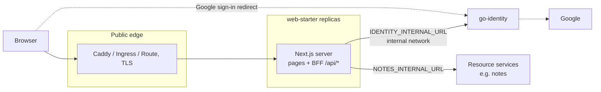
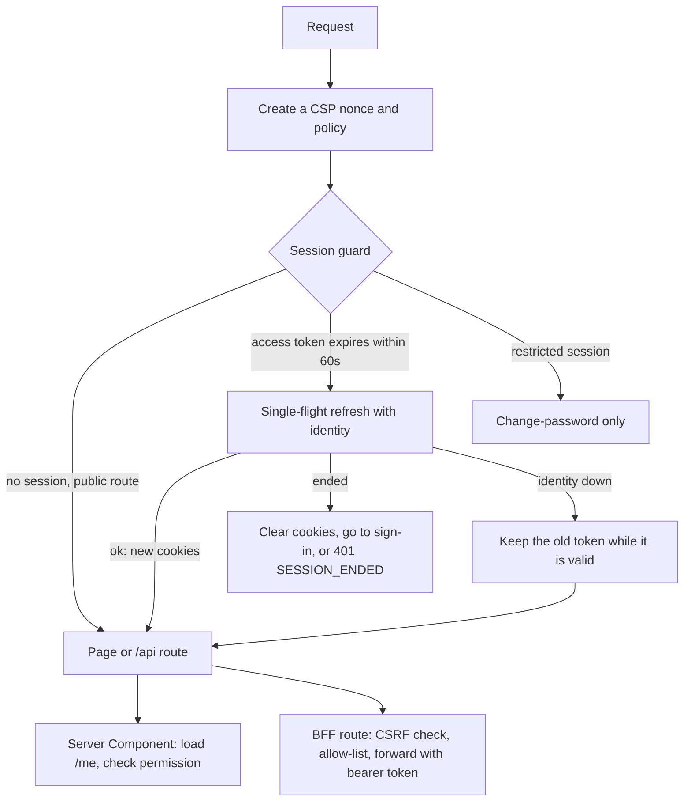
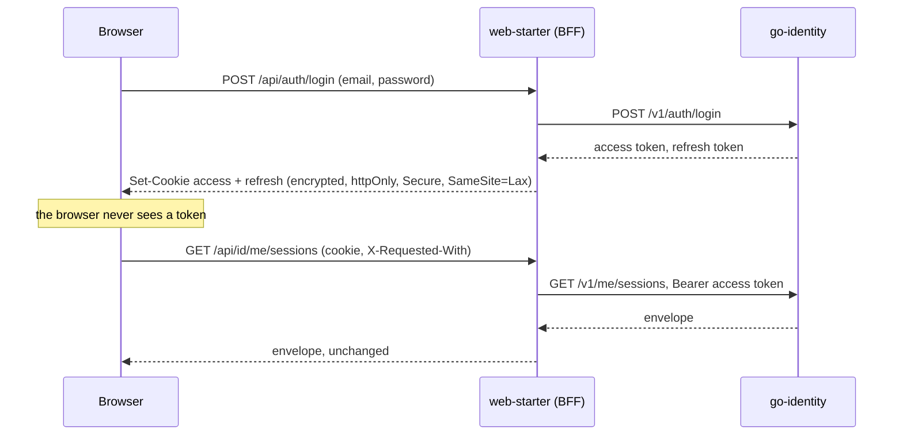
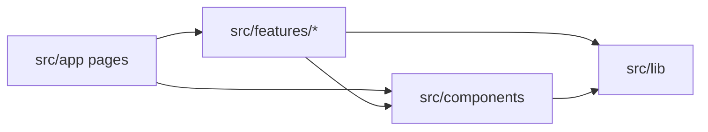

# Architecture

This is the map of web-starter for an engineer new to it. It explains how the app is deployed, how a page or API
call moves through it, how the session works, how the code is organised, and the patterns it repeats. Read it before
the code.

Related documents:

- [README](../README.md) runs it.
- [CONTRIBUTING](../CONTRIBUTING.md) and [AGENTS](../AGENTS.md) are the rules for changes.
- [DESIGN](../DESIGN.md) is the visual contract, and [UI_REVIEW_WORKFLOW](../UI_REVIEW_WORKFLOW.md) the UI process.
- [deploy.md](deploy.md) covers the image and environment, and [adding-a-module.md](adding-a-module.md) adds a business
  screen.
- [DECISIONS](DECISIONS.md) records why things are the way they are.
- The specs (PRD, TRD, APP_FLOW) live in the workspace's `phase2/frontend/` folder.

## Contents

1. [What the app is](#1-what-the-app-is)
2. [Deployed system](#2-deployed-system)
3. [Inside one request](#3-inside-one-request)
4. [The session](#4-the-session)
5. [Code organisation](#5-code-organisation)
6. [Integrating identity and resource services](#6-integrating-identity-and-resource-services)
7. [Patterns](#7-patterns)
8. [Where to look in the code](#8-where-to-look-in-the-code)

## 1. What the app is

The web app every client project starts from: sign-in, sign-up and account screens, an admin console (users, roles,
tenants, audit log), and a slot for business screens (the example is notes). It is a Next.js App Router app whose
server is also a **BFF** (backend for frontend): the browser only ever talks to this app, and this app talks to
[go-identity](https://github.com/biairmal/go-identity) and the resource services.

| Term               | Meaning                                                                                                |
| ------------------ | ------------------------------------------------------------------------------------------------------ |
| BFF                | The app's own `/api/*` route handlers. They hold the tokens and call upstream services for the browser |
| Upstream           | A service the BFF calls: identity, or a resource service such as notes                                 |
| Session            | The encrypted, `httpOnly` cookies that hold the access and refresh tokens                              |
| Restricted session | The short-lived cookie for a forced password change. It can reach only the change-password page        |
| Feature            | A folder in `src/features` holding one area's components and data hooks                                |

## 2. Deployed system



- **One image, configured only by environment variables**, runs on Compose next to identity or on Kubernetes or
  OpenShift ([deploy.md](deploy.md)).
- **Stateless replicas.** The session is in the browser's cookies, so any replica serves any request.
- **Readiness follows identity.** `/api/readyz` answers 503 while identity's `/readyz` doesn't answer within 1
  second. The replica leaves the load balancer but isn't restarted.
- **Upstreams are reached on the internal network.** Only the Google redirect sends the browser to identity's public
  origin (`IDENTITY_PUBLIC_URL`).

## 3. Inside one request

Every page and `/api` request passes through `src/middleware.ts` first:



- **Pages** are Server Components. They load the signed-in user from identity once per request (`src/lib/session/me.ts`)
  and check the page's permission on the server (`require-permission.ts`). A missing permission renders the
  forbidden page.
- **Client components** fetch through TanStack Query hooks in their feature folder, which call `/api/id/*` (identity)
  or `/api/<service>/*` (resource services) with the generated, typed client.
- **BFF routes** check CSRF on every mutating request, forward only allow-listed paths, add the session's bearer
  token, and return the upstream status and envelope unchanged.
- **Route access rules are data** in `src/lib/session/route-rules.ts`: public pages, pages a signed-in user is sent
  away from, BFF routes that run without a session, and what a restricted session may reach.

## 4. The session



| Cookie     | Holds                                            | Lifetime                        | SameSite |
| ---------- | ------------------------------------------------ | ------------------------------- | -------- |
| Access     | The access token and its claims                  | Token expiry plus 60 seconds    | Lax      |
| Refresh    | The refresh token, its expiry and the session ID | Identity's `refresh_expires_in` | Lax      |
| Restricted | A `password_change` token                        | At most 10 minutes              | Strict   |

- **Encryption.** Cookies are JWE (`dir`, A256GCM) under a key ring built from `SESSION_SECRET`. The first key
  encrypts, and every key decrypts, so keys rotate without signing anyone out (`src/lib/session/crypto.ts`).
- **Refresh.** The guard refreshes when the access token has less than 60 seconds left. Refresh is single-flight
  per session: concurrent requests share one upstream call, and a settled result is reused briefly, so a request
  carrying the old cookie never presents a rotated refresh token (`refresh.ts`).
- **Ending.** Sign-out, `logout-all`, or a refresh that identity refuses clears the cookies. The tab broadcasts it,
  and other tabs recheck the session at the user's next action (`src/lib/session-sync.ts`).
- **Google sign-in.** The browser goes to identity's `/v1/auth/google/start`. Identity redirects back to
  `/auth/callback` with a one-time code, which the server exchanges for tokens, so no token appears in a URL.

## 5. Code organisation

```text
src/app/             routes (App Router)
  (public)/          sign-in, sign-up, invite, password reset, email verification
  (restricted)/      change-password, for the restricted session
  (app)/             the signed-in shell: account, admin/*, notes
  api/               the BFF: auth/* (sign-in flows), id/[...path] and notes/[...path] (proxies), session, health
  auth/              Google callback and session re-check (route handlers that set cookies)
src/features/        one folder per area: components + TanStack Query hooks (useUsers, useRole)
src/components/      shared UI: ui/ (shadcn primitives), layout/, forms/, data-table/, filters/, feedback/
src/lib/             session/, bff/, api/ (generated types, client, query keys), authz/, security/
src/config/          env validation, brand, navigation, password policy
messages/            en.json (source) and id.json
openapi/             identity.yaml and notes.json, copied from the services
```



- **Features never import other features** (ESLint `import/no-restricted-paths`). Pages compose features and stay
  thin. Shared code goes in `src/components` or `src/lib`.
- **Server-only code** (`src/lib/session`, `src/lib/bff`, `src/config/env.ts`) starts with `import "server-only"`, so
  importing it from a client component fails the build.
- **API types are generated** from the OpenAPI files (`bun run api:gen`). Nothing hand-writes an identity payload
  type, and `bun run api:check` fails when the generated types are stale.
- **All text goes through `next-intl`**, and **all styling through design tokens** (`src/app/tokens.css`), so a client
  rebrand touches `src/config/brand.ts`, the tokens and the font, not the components.

## 6. Integrating identity and resource services

- **Identity** is reached through `/api/id/*`. Its allow-list (`src/lib/bff/allowlist.ts`) names exactly the
  `/v1/me`, `/v1/admin` and super-admin paths the browser may use. Routes that set cookies (sign-in, password change,
  tenant switch, sign-out) are dedicated handlers under `/api/auth/*`.
- **A resource service** gets its own catch-all proxy, for example `src/app/api/notes/[...path]/route.ts`. It is
  `createServiceProxy` with the service's internal URL and allow-list. The service trusts identity's tokens, so the
  BFF forwards the same bearer token. [adding-a-module.md](adding-a-module.md) has every step.
- **Permissions in the UI** (`src/lib/authz/can.ts`) match go-sdk `authz` exactly (`*`, `resource:*`, `:any`), but
  only shape navigation and buttons. The upstream service enforces every rule.

## 7. Patterns

| Pattern                    | Problem                                                                             | How                                                                                                                                         |
| -------------------------- | ----------------------------------------------------------------------------------- | ------------------------------------------------------------------------------------------------------------------------------------------- |
| BFF with an allow-list     | The browser must not hold tokens, and the BFF must not become an open proxy         | Same-origin `/api/*` routes add the bearer token, forward only listed paths, refuse odd path segments, and pass the envelope back unchanged |
| Single-flight refresh      | Parallel requests would each rotate the refresh token, and identity would see reuse | One refresh per session at a time, with the result shared by every waiting request                                                          |
| Origin + header CSRF check | Cookie auth is open to cross-site forms                                             | Mutating `/api` requests need this app's `Origin` and `X-Requested-With`, which a cross-site form can't send                                |
| Nonce CSP per request      | Injected scripts                                                                    | The middleware creates a nonce, and only scripts with it run                                                                                |
| Cross-tab session sync     | A signed-out tab keeps showing data                                                 | A `BroadcastChannel` message, then a session recheck at the user's next action                                                              |
| Server errors onto forms   | Field errors from identity must land on the right input                             | `applyServerErrors` maps the envelope's `meta.fields` onto React Hook Form                                                                  |
| Generated API types        | Hand-written payload types drift from the API                                       | `openapi/` is copied from each service, and types are generated and checked in CI                                                           |
| Route rules as data        | Access logic scattered across pages                                                 | `route-rules.ts` lists public, signed-in-only and restricted routes in one place                                                            |

## 8. Where to look in the code

| Question                                    | Open                                                             |
| ------------------------------------------- | ---------------------------------------------------------------- |
| What runs on every request?                 | `src/middleware.ts`, `src/lib/session/guard.ts`                  |
| How are cookies built and read?             | `src/lib/session/cookies.ts`, `crypto.ts`                        |
| Which upstream paths may the browser reach? | `src/lib/bff/allowlist.ts`                                       |
| How does a page check a permission?         | `src/lib/session/require-permission.ts`, `src/lib/authz/can.ts`  |
| How does a client component call the API?   | `src/lib/api/client.ts`, `query-keys.ts`, a feature's `use-*.ts` |
| Which pages are public?                     | `src/lib/session/route-rules.ts`                                 |
| How do I add a business screen?             | [adding-a-module.md](adding-a-module.md)                         |
| How do I deploy it?                         | [deploy.md](deploy.md)                                           |
